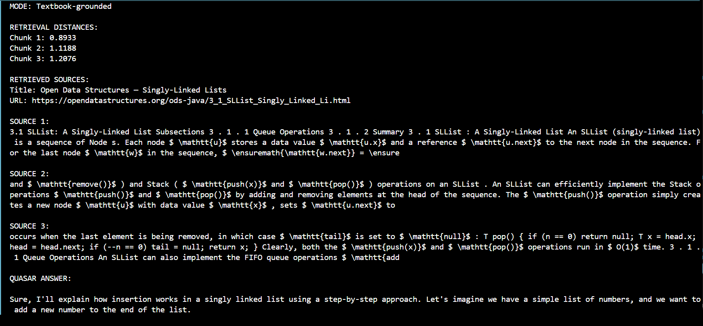
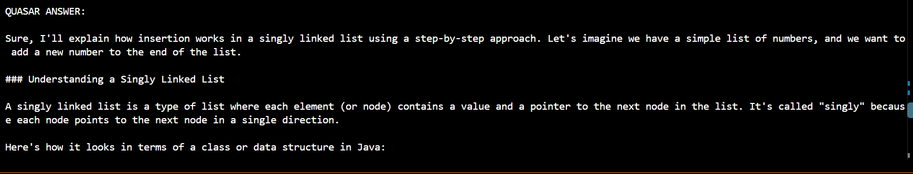
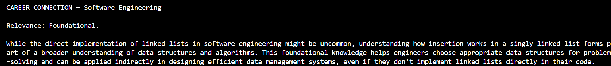

# Hyperlane — GMU CS Career Map

**GMU Computer Science Career Map | AWS Deployment | RAG AI Prototype**

Hyperlane is an interactive career exploration platform I built to help George Mason University computer science students understand how their coursework connects to careers in tech.

Throughout my degree, I've sometimes struggled to see how certain concepts I'm learning in class apply to actual jobs in the industry. I wanted to build something that makes those connections easier to understand.

The project also gave me an opportunity to gain hands-on experience with two areas I've been interested in: **Cloud Engineering and AI Engineering**.

**[Live Demo](http://3.239.184.192) | [GitHub Repository](https://github.com/Raheem-12/gmu-career-map)**

**Project status:** The Career Map is publicly deployed on AWS. Quasar AI, the RAG-based study assistant, currently runs locally and is not yet integrated into the live website.

## What Hyperlane Does

### Interactive Career Map

Hyperlane connects GMU computer science courses to four career paths:

- Software Engineering
- Cloud & DevOps
- Cybersecurity
- IT & Systems

Students can explore how different courses relate to these fields and why certain concepts are useful in industry.

### AI-Era Learning Strategy

I also included a section focused on learning effectively in an AI-driven environment, covering skills such as understanding code, debugging, and using AI tools without becoming overly dependent on them.

### Quasar AI — RAG Study Assistant

Quasar is a local AI study assistant I developed to better understand Retrieval-Augmented Generation (RAG).

Instead of relying entirely on an LLM's existing knowledge, Quasar retrieves relevant textbook material and uses it as context when answering questions.

The current prototype focuses on CS310 linked lists and can also explain how a concept relates to a student's selected career path.

## Cloud Engineering

One of my main goals was to gain practical experience deploying an application to AWS rather than just running it locally.

I used:

- **Docker** to package the application into a container.
- **Nginx** to serve the application inside the container.
- **Terraform** to provision AWS infrastructure.
- **Amazon EC2** to host the application publicly.
- **Amazon ECR** to store Docker images.
- **GitHub Actions** to build and deploy application updates.

I also configured a manually triggered deployment workflow with health checks to verify that the updated application is running.

This part of Hyperlane helped me better understand how infrastructure, containers, and deployment automation work together.

## AI Engineering — Building Quasar with RAG

For the AI portion, I wanted to understand how an LLM could answer questions using external educational material.

Rather than using a prebuilt RAG service, I implemented the main components myself in Python.

I started with one topic, linked lists from CS310, and built the following pipeline:

**1. Data Ingestion**

Used Python, Requests, and BeautifulSoup to extract linked-list material from the *Open Data Structures* textbook.

**2. Text Chunking**

Split the textbook content into 200-word chunks with 50 words of overlap to preserve context between neighboring passages.

**3. Embedding Generation**

Used Sentence Transformers (`all-MiniLM-L6-v2`) to convert the text chunks into numerical vectors that represent their meaning.

**4. Vector Storage**

Stored the embeddings, textbook passages, and source information in ChromaDB.

**5. Semantic Retrieval**

When a student asks a question, Quasar converts the question into an embedding and searches ChromaDB for the three closest matching passages, filtered by course.

**6. LLM Response Generation**

The retrieved passages are passed to Qwen 2.5 3B, running locally through Ollama, to generate an explanation based on the textbook material.

I also implemented a retrieval relevance threshold. When the retrieved material doesn't meet that threshold, Quasar switches to a general-knowledge response and labels it accordingly.

Students can optionally select a career field to receive an AI-generated explanation of how the concept relates to that career.

### Quasar AI — Local Test

I tested Quasar locally with the question **“How does insertion work in a singly linked list?”**, using **CS310** and **Software Engineering** as the selected course and career.

**1. Textbook retrieval** — Quasar retrieves course-specific passages from *Open Data Structures* and displays the source and retrieval distances.

**2. Generated explanation** — The retrieved passages are supplied as context to the locally running LLM.

**3. Career connection** — Quasar separately evaluates how the concept relates to the selected career, in this case classifying the relevance as **Foundational**.

These are screenshots from a local terminal run, not the publicly deployed website. The prototype has been tested end-to-end, but answer quality and retrieval thresholds still need broader evaluation.

## Technologies Used

| Cloud Engineering | AI Engineering |
|---|---|
| AWS EC2 | Python |
| Amazon ECR | Retrieval-Augmented Generation (RAG) |
| Terraform | Sentence Transformers |
| Docker | ChromaDB |
| Nginx | Ollama |
| GitHub Actions | Qwen 2.5 3B |
| CI/CD | BeautifulSoup |

## Project Status

**Completed and deployed**

- Interactive GMU CS Career Map
- AI-Era Learning Strategy
- Docker containerization
- AWS infrastructure provisioned with Terraform
- Public deployment on EC2
- GitHub Actions deployment workflow

**Completed locally**

- Quasar AI RAG pipeline
- Textbook ingestion, chunking, embeddings, and vector storage
- Semantic retrieval and local LLM integration
- Career relevance explanations

**Not yet deployed**

- Quasar AI integration with the public website

## What I Learned

Hyperlane helped me connect two areas of technology that I wanted to understand beyond the classroom.

On the cloud side, I gained experience with infrastructure provisioning, containerization, and automated deployments.

On the AI side, I learned how RAG works by implementing each stage of the pipeline and testing how retrieved information influences an LLM's responses.

The project started with a problem I experienced as a CS student, but it also became a way to apply and develop practical cloud and AI engineering skills.
